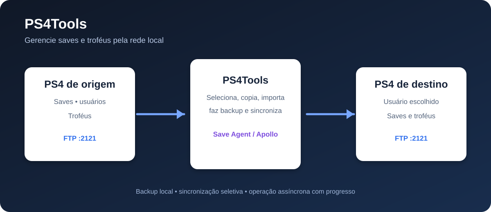

# PS4Tools

<p align="center">
  
</p>

<p align="center"><strong>Ferramenta Windows para gerenciar, fazer backup e sincronizar saves e troféus entre consoles PS4.</strong></p>

<p align="center">
  
  
  
</p>

> O PS4Tools é voltado a consoles PS4 com acesso FTP habilitado. Ele não é um desbloqueio, não substitui o GoldHEN e não remove a necessidade dos payloads/ferramentas compatíveis no console.



## O que é

O PS4Tools é um utilitário desktop desenvolvido em Delphi para simplificar tarefas que normalmente exigem navegar manualmente pelos arquivos do PS4. A aplicação conecta-se aos consoles pela rede local, identifica usuários e jogos e permite trabalhar de forma seletiva com os dados escolhidos.

O projeto possui interface multilíngue — português, inglês, espanhol, alemão, francês, russo e japonês — e executa operações demoradas em segundo plano, exibindo log e progresso.

## Principais recursos

### Saves

- listar os usuários disponíveis no PS4;
- carregar os saves do usuário selecionado;
- sincronizar saves selecionados entre dois PS4;
- copiar saves entre usuários diferentes no mesmo console;
- exportar saves descriptografados para uma pasta local;
- importar backups locais para um usuário do PS4;
- excluir saves selecionados;
- escolher individualmente quais jogos serão processados.

### Troféus

- carregar a lista de títulos e o progresso de troféus de cada usuário;
- copiar títulos selecionados entre usuários/consoles;
- fazer backup do estado de troféus;
- restaurar um backup;
- excluir títulos selecionados;
- ordenar os títulos alfabeticamente.

As operações de troféus trabalham com o banco `trophy_local.db` do usuário. Faça um backup antes de qualquer alteração.

### Modos de sincronização de saves

| Modo | Quando usar | Como funciona |
|---|---|---|
| **Manual** | Quando você quer controlar a importação pelo Apollo | Copia os saves criptografados para o Fake USB do Apollo no PS4 de destino. Depois, o Apollo deve importar/assinar os saves e copiá-los para o HDD. |
| **Automático — mesmo PS4** | Para copiar entre dois usuários no mesmo console | Usa o payload para montar/descriptografar o save de origem, copiar o conteúdo para o usuário de destino e desmontar o save para o PS4 recriptografá-lo. |
| **Automático — dois PS4** | Para transferir entre consoles diferentes | Cria um backup descriptografado no PC e usa o **PS4 Save Agent** no console de destino para recriar/recriptografar o save para o usuário selecionado. |

## Requisitos

- Windows 10 ou superior;
- PS4 e PC na mesma rede local;
- FTP do PS4 habilitado e acessível na porta `2121`;
- GoldHEN ou ambiente compatível para executar payloads, quando o modo automático for usado;
- Apollo Save Tool no modo manual;
- **PS4 Save Agent** instalado no PS4 de destino para a sincronização automática entre dois consoles;
- Account ID ativado para os usuários envolvidos quando o fluxo automático solicitar essa ativação;
- backups próprios e autorização para modificar os dados dos consoles.

## Download e execução

Na página de releases do GitHub, baixe o pacote para Windows e extraia-o mantendo a estrutura de pastas. O executável distribuído pelo projeto é:

```text
Win32/Debug/PS4Tools/PS4Tools.exe
```

Execute `PS4Tools.exe` como usuário normal. Mantenha na mesma pasta os componentes e payloads distribuídos com o pacote. O programa salva suas preferências de IP, idioma e modo de sincronização localmente.

## Como usar — saves

1. Inicie o FTP no(s) PS4 e confirme que o PC consegue alcançar o(s) endereço(s) IP.
2. Abra o PS4Tools e informe o IP de origem e o IP de destino. Para operações no mesmo console, informe o mesmo IP nos dois campos.
3. Clique em **Carregar usuários**.
4. Selecione o usuário de origem e o usuário de destino. No mesmo PS4, eles precisam ser diferentes.
5. Carregue os saves do usuário de origem e marque os jogos desejados.
6. Escolha **Automático** ou **Manual**.
7. Clique em **Iniciar sincronização**, revise a confirmação e aguarde o log indicar a conclusão.
8. No modo manual, abra o Apollo no PS4 de destino, importe/assine os saves do Fake USB e copie-os para o HDD.

### Exportar e importar um save

Na aba **Saves**, carregue os jogos do usuário desejado, selecione os itens e use **Exportar save**. O backup descriptografado será salvo na pasta `Saves descriptografados`, criada ao lado do executável. Para restaurar, use **Importar save**, escolha a pasta do backup e selecione o usuário de destino.

## Como usar — troféus

1. Abra a aba **Troféus**.
2. Informe os IPs e carregue os usuários.
3. Selecione um usuário em cada lado e clique em **Carregar troféus**.
4. Marque os títulos desejados.
5. Use **Backup** antes de editar; depois escolha **Copiar**, **Excluir**, **Ordenar** ou **Restaurar** conforme necessário.

## PS4 Save Agent

O repositório inclui o payload e o código-base em `tools/ps4-save-agent`. O binário esperado pelo aplicativo é:

```text
payloads/ps4-save-agent.elf
```

No PS4, o Agent deve estar disponível em `/data/payloads/ps4-save-agent.elf` e normalmente é iniciado pelo menu de payloads do GoldHEN. O Agent expõe uma API HTTP local na porta `8084` para operações de exportação, importação e sincronização descriptografada.

> O payload depende de um SDK de PS4 compatível e de funções internas do sistema, como montagem PFS. O PC não consegue realizar essas etapas sozinho. Consulte [`tools/ps4-save-agent/README.md`](tools/ps4-save-agent/README.md) para a especificação da API e do build.

## Segurança e recomendações

- Faça backup antes de importar, excluir, copiar troféus ou sincronizar saves.
- Não interrompa o PS4, o FTP ou o aplicativo enquanto uma operação estiver em andamento.
- Nunca use arquivos de save de origem desconhecida ou incompatíveis com o jogo/versão do sistema.
- Confirme duas vezes os IPs e os usuários: uma operação no destino pode substituir dados existentes.
- Use a ferramenta somente em consoles e dados que pertencem a você ou para os quais você tem autorização.

## Estrutura do projeto

```text
PS4Tools.dpr                 Projeto principal Delphi
sources/                     Código-fonte da interface e das operações
components/                  Componentes e payloads auxiliares
payloads/                    Payloads e logs do PS4 Save Agent
tools/ps4-save-agent/        Código e documentação do Agent
images/                      Ícones e imagens da documentação
```

## Desenvolvimento

O projeto é um aplicativo VCL Delphi. Para compilar, abra `PS4Tools.dproj` em uma versão compatível do RAD Studio/Delphi, verifique as dependências Indy e SQLite incluídas/configuradas e compile para Windows. O projeto gera o executável em `Win32/Debug/PS4Tools/` na configuração atualmente utilizada.

## Status

O aplicativo desktop possui os fluxos de FTP, saves, troféus, backups e traduções implementados. O **PS4 Save Agent** é um componente separado e depende da compilação/execução de código específico do PS4; valide esse payload no seu ambiente antes de usar a sincronização automática entre consoles.

## Licença

Nenhum arquivo de licença foi identificado neste repositório. Antes de redistribuir ou incorporar o projeto em outro produto, confirme os direitos sobre o código, os componentes e os assets de terceiros incluídos.
